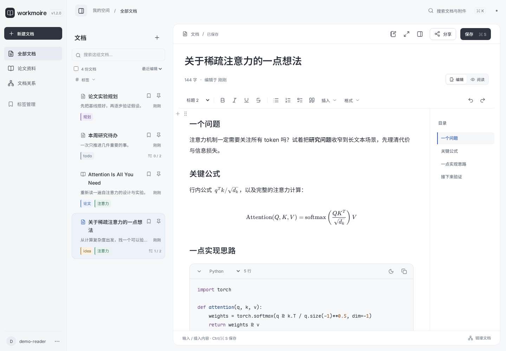

# Workmoire · 拾序

**中文** · [English](README.en.md)

自托管的学术笔记与论文阅读工具。用富文本文档记录思路、阅读 PDF，并通过标签和文档链接组织资料。

[快速开始](#快速开始) · [使用说明](docs/user-guide.md) · [更新日志](CHANGELOG.md) · [版本发布](https://github.com/ZAIQuQ/Workmoire/releases)



## 能做什么

- **写文档**：富文本、公式、图片、待办、行内代码和可折叠代码块；支持 Tab 缩进、整篇字体、选区颜色与右侧目录。单行工具栏和紧凑标题区为正文留出空间，专注模式隐藏底栏。输入 `/` 插入内容，支持中文、拼音首字母和英文检索。
- **排表格**：默认适应正文宽度，一键均分列宽；取消固定宽度后可横向滚动。
- **读论文**：手动上传 PDF，可附来源链接；服务不会自动下载论文。PDF 可直接嵌入文档阅读；上传显示实际进度，AI 整理发表、作者团队与两级领域，生成 1–2 个领域标签、中英摘要对照和聚焦洞见与技术要点的阅读笔记，并给出预估等待时间。
- **组织资料**：文档目录展示彩色标签，置顶旁即可维护；文档链接连接相关思路。新建只有「空白文档」和「论文资料」。
- **分享文档**：生成带复杂密码的只读快照，选择 1 天、7 天、30 天或永久有效，随时改密或撤销。
- **保留修改**：本机草稿、保存冲突检测、版本历史、回收站，以及 JSON / 完整归档导入导出。

Codex 整理与阅读笔记生成是**可选功能**，默认关闭；启用后，选中的材料会交给本机 CLI 及其配置的模型服务。生成结果需要确认、插入和保存。

## 快速开始

需要 **Python 3.10–3.12**。运行服务只用 Python 标准库；编辑器、字体和 PDF 阅读器已随仓库打包，无需 Node.js 或 CDN。

```bash
git clone https://github.com/ZAIQuQ/Workmoire.git
cd Workmoire
cp .env.example .env
chmod 600 .env
```

编辑 `.env`：

- 本机使用时设置 `WORKSPACE_HOST=127.0.0.1`。
- 设置 `WORKSPACE_DATA_DIR`，将数据放在源码目录之外。
- 将 `WORKSPACE_SESSION_SECRET` 换成长随机值。对外开放首次注册时，还必须设置独立的 `WORKSPACE_SETUP_TOKEN`。

随机值可以用 `python3 -c 'import secrets; print(secrets.token_urlsafe(32))'` 生成。初始化令牌只用于创建首个账号，之后使用账号密码登录。

```bash
python3 workspace_server.py
```

打开 [localhost:5200](http://localhost:5200)，创建你的账号。

使用中遇到问题，可从页面右下角「上报 Bug」提交截图和复现说明，再从用户菜单的「Bug 记录」只读查看。[了解上报流程](docs/bug-reports.md)。

## 部署与数据

| 服务 | 默认端口 | 用途 |
| --- | --- | --- |
| 主站 | `5200` | 登录、编辑、资料管理 |
| 分享服务（单独启用） | `5201` | 密码保护的只读快照 |

分享服务使用独立系统账号和数据目录，不能读取整个私有文档库。配置见[文档分享部署指南](docs/document-sharing.md)；主站和备份定时任务提供 [systemd 示例](deploy/systemd/)。主站也可使用 `docker compose up -d --build`，数据保存在命名卷中；Docker 默认不启用分享和 Codex。

生产访问请配置 HTTPS，并备份数据库、附件和分享密钥。分享的是生成时的已保存版本，后续编辑不会自动公开；已下载的内容无法收回。

```bash
WORKSPACE_DATA_DIR=/path/to/private-data ./backup.sh /path/to/private-backups
```

完整配置、数据恢复和编辑说明见[使用指南](docs/user-guide.md)、[论文导入](docs/paper-intake.md)和[安全说明](SECURITY.md)。

## 开发

推荐 Node.js 22.13+ 或更新的 LTS 版本进行构建和浏览器测试。

```bash
npm ci
npm run build
make compile
make test
npx playwright install --with-deps chromium
npm run test:browser
```

测试使用独立的临时数据。较大改动完成后，按[发布流程](docs/releases.md)更新版本与日志，验证部署，再同步 GitHub。

## 许可证

[MIT](LICENSE)。本地打包的依赖、图标和字体保留各自的[许可证与来源](workspace/static/THIRD_PARTY_ASSETS.md)。
